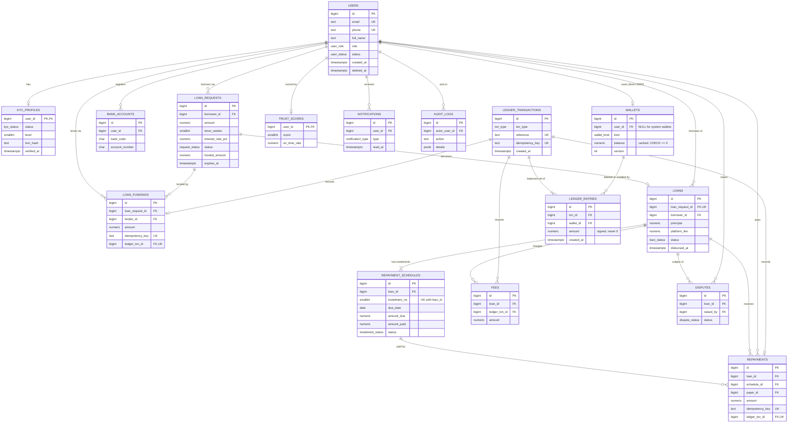

# Copay entity relationship diagram

Source text (Mermaid). To produce `er-diagram.png`, paste the block into https://mermaid.live and export PNG, or run `npx @mermaid-js/mermaid-cli -i er-diagram.md -o er-diagram.png` (needs Node.js). Save the PNG in this folder.

## Reading the diagram

- **Money flows only through the ledger.** `LEDGER_TRANSACTIONS` is the header and `LEDGER_ENTRIES` are the signed legs. `LOAN_FUNDINGS`, `REPAYMENTS` and `FEES` point at the ledger transaction that moved the money, so a business event can always be traced to its accounting record.
- **System wallets.** `WALLETS.user_id` is NULL for the three system wallets (EXTERNAL, ESCROW, FEES). They give every movement a counterparty, which is what makes double entry possible.
- **One request, one loan.** `LOANS.loan_request_id` is unique, so a request becomes at most one loan, created only after it is fully funded.
